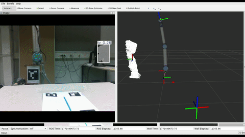

# UR10_Final_Project

## Name
Multi-sensory Based Robot Dynamic Manipulation final project - Visual Servo Tracking and Picking of Unknown Objects.

## Description
Control your UR10 to dynamically track desired objects with YOLOv8 in real-time and pick them up.

## Demo Video



# Requirements
- Docker 
- RGB-D Camera (Realsense)
- UR10

## Usage
### 1. Clone the repository
```
git clone https://gitlab.lrz.de/hjgrant/ur10_final_project.git
```
### 2. Build and Launch the DevContainer
Make sure too adjust the path of the worksapce in the ```devcontainer.json``` to the loation where you cloned the repo to. Then press ```ctrl+p``` in VSCode and select ```Dev Container: Rebuild and Reopen in Container```.

### 3. Connect to the UR10
Make sure you have given your host machine a static IP in the same subnet as the UR10's IP address, we tested with a static IP of ```192.168.1.3```. Make sure to set the correct ROSMASTER IP, an alias has been set to simplify this. Run the following inside the container, 

``` 
rosmaster_ur10 
```

make sure you can ping the robot, try

``` 
ping 192.168.1.10
 ```

and the gripper

``` 
ping 192.168.1.20
```
make sure to change line 5 in ```src/tum_ics_ur10_controller_tutorial/launch/configs/configUR10.ini``` to 'real'.

### 4. Build the workspace
Navigate to ```UR10_FINAL_PROJECT\``` and run ```catkin build```, then wait for the build process to finish.

### 5. Initialize the pipeline
Inside the container, open one terminal and run ```roscore``` to start the ros master. Then open another terminal and run the script manager
```
roslaunch tum_ics_ur_robot_manager robot_script_manager_ur10.launch
```
open another terminal an run the gripper driver 
```
roslaunch wsg_50_driver wsg_50_tcp.launch 
```
open another terminal and make sure you home the gripper
``` 
rosservice call /wsg_50_driver/homing 
```
open another terminal and run RViz for the visualization 
```
roslaunch tum_ics_ur10_bringup bringUR10.launch 
```
### 6. Calibrate the camera pose
To calibrate the camera pose, point the Realsense camera at the ARUCO marker mounted on the robot's base link, then run the following to launch the camera, the object detection and the camera pose calibration 
```
roslaunch my_visual_servoing visual_servo_realsense.launch 
```
check the terminal output and wait until the calibration process has finished, i.e. 100 measurements of the ARUCO marker have been recorded.

> [NOTE]
> If you do not see the calibration measurements counting up to 100, look at
the output of the topic /aruco_single in RViz and move the camera until you see a frame projected onto the ARUCO marker. 

After the calibration procedure is completed there will be a message in the terminal that reads "SUCCESS!". Be sure not to move the camera otherwise you will have to repeat this calibration process.

### 7. Run the tracking and picking pipeline
Now that you have successfully calibrated the camera pose, run the following launch file to start the tracking pipeline, 

```
roslaunch tum_ics_ur10_controller_tutorial visual_servo_controller.launch
```

after the robot has moved into it's starting configuration, you can introduce the target object (pre-configured to class 'bottle') into the workspace. The end-effector will track the object. Once you are ready for the robot to grasp the object, keep the position and orientation of the object still for 10s. After 10s the robot will start a grasping routine. 